# ⚡ Azure Functions
{: .no_toc }

**★ Serverless compute — event-driven, trigger-based code execution at any scale**
{: .fs-5 .fw-300 }

---

## Table of Contents
{: .no_toc .text-delta }

1. TOC
{:toc}

---

## Product Overview

Azure Functions is a **serverless compute service** that runs small units of code (functions) in response to triggers — without provisioning or managing servers. You pay only for the time your code executes. Functions is the right answer when the workload is **event-driven, short-lived, and stateless** — reacting to HTTP requests, queue messages, timer events, blob uploads, or any Azure service event.

```mermaid
flowchart LR
    subgraph Triggers["Triggers (what starts a function)"]
        HTTP["HTTP Request"]
        TMR["Timer (cron)"]
        SBQ["Service Bus Queue/Topic"]
        STQ["Storage Queue"]
        EH["Event Hub"]
        EG["Event Grid"]
        BLOB["Blob Storage"]
        COD["Cosmos DB (change feed)"]
    end
    subgraph FA["Function App"]
        F1["Function 1\n(HTTP trigger)"]
        F2["Function 2\n(Queue trigger)"]
        F3["Function 3\n(Timer trigger)"]
    end
    subgraph Outputs["Output Bindings (what the function writes)"]
        SQLO["Storage Queue"]
        SBO["Service Bus"]
        COSMO["Cosmos DB"]
        BLOBO["Blob Storage"]
        TABLEO["Table Storage"]
        SIGR["SignalR"]
    end
    Triggers --> FA
    FA --> Outputs
```



---

## Hosting Plans
{: #hosting-plans }

The hosting plan is the **most exam-critical decision** for Azure Functions — it determines scaling behaviour, cost, VNet support, cold start exposure, and execution duration limits.

| Feature | Flex Consumption | Consumption (legacy) | Premium | Dedicated (App Service) |
|---------|-----------------|---------------------|---------|------------------------|
| **Status** | GA — recommended serverless plan | Legacy — Linux retiring **30 Sep 2028** | GA | GA |
| **OS** | Linux only | Windows (Linux retiring) | Windows, Linux | Windows, Linux |
| **Billing** | Per execution + GB-s while executing (+ always-ready baseline) | Per execution + GB-s | Per pre-warmed instance | Per App Service Plan hour |
| **Scale** | Auto, per function (0 → 1,000 per function group) | Auto (0 → 200 Windows / 100 Linux) | Auto (min 1 → 100 Windows / 20–100 Linux) | Manual or auto-scale (10–30; 100 on ASE) |
| **Scale to zero** | ✅ | ✅ | ❌ (min 1 pre-warmed) | ❌ |
| **Cold start** | Reduced; always-ready instances reduce it further | ✅ Yes (after idle) | ❌ No (pre-warmed) | ❌ No |
| **Max execution duration** | **30m** (default) / **Unbounded** (max) | **5m** (default) / **10 minutes** (max) | **30m** (default) / **Unbounded** (max) | **30m** (default) / Unbounded (requires Always On) |
| **VNet Integration** | ✅ | ❌ | ✅ | ✅ |
| **Private Endpoints** | ✅ | ❌ | ✅ | ✅ |
| **VNET trigger support** | ✅ (native) | ❌ | ✅ | ✅ |
| **Custom VM size** | Instance memory 512 MB / 2 GB / 4 GB | ❌ | ✅ (EP1–EP3) | ✅ |
| **Always Ready instances** | ✅ (optional, default 0) | ❌ | ✅ (configurable) | N/A |
| **Deployment slots** | ❌ (rolling updates) | ✅ 2 (production + 1 staging) | ✅ 3 | ✅ 1–20 (by tier) |
| **Best for** | New serverless apps, incl. VNet access | Existing Windows-dependent serverless apps | No cold start, VNet access, custom Linux container | Predictable load, existing App Service Plan |

**Unbounded** means no maximum is enforced, but a running execution gets only a **60-minute grace period** during scale-in (Flex Consumption, Premium) and **10 minutes** during platform updates. Functions can also run on **Azure Container Apps** (GA) as containerised function apps — see [05 — Azure Container Apps](/az-305-compute/05-container-apps/).

> ⚠️ **Exam Caveat — Consumption Plan Limitations (Most Tested):** These limits apply to the legacy **Consumption** plan, not to Flex Consumption.
> - **No VNet Integration** — cannot reach private resources (SQL MI, internal APIs); use **Flex Consumption** or **Premium**
> - **10-minute execution timeout** — long-running operations must use Durable Functions or a Flex Consumption, Premium, or Dedicated plan
> - **Cold starts** — first invocation after idle period has latency; unacceptable for latency-sensitive paths
> - **No private inbound** — function endpoint is always public on Consumption

> ⚠️ **Exam Caveat — Flex Consumption Is the Serverless Answer for VNet Access:**
> - **Flex Consumption** (GA) is Microsoft's recommended serverless plan: scale to zero and pay per execution, **plus** VNet Integration, private endpoints, and optional always-ready instances
> - If a scenario needs **serverless billing and private network access** and Flex Consumption is an answer option, choose it. If the options are only Consumption, Premium, and Dedicated, the answer is still **Premium**
> - Flex Consumption is **Linux only**, hosts **one app per plan**, and has **no deployment slots**. With a Windows dependency (for example full .NET Framework), the serverless option is the legacy **Consumption** plan
> - The **Linux Consumption** plan retires on **30 September 2028** and gets no new features or language versions. Windows Consumption isn't affected yet

> ⚠️ **Exam Caveat — HTTP Functions Must Respond Within 230 Seconds:** On **every** plan, an HTTP-triggered function must return a response within **230 seconds** (the Azure Load Balancer idle timeout), whatever `functionTimeout` is set to. For longer work, use the **Durable Functions async HTTP pattern** or queue the work and return immediately.

> ⚠️ **Exam Caveat — Premium Plan vs Dedicated:**
> - Use **Premium** when you need auto-scale AND no cold start (pre-warmed instances) AND VNet Integration, or when you need Windows or a custom Linux container (Flex Consumption is Linux code-only)
> - Use **Dedicated** when the Function App should share an existing App Service Plan and you want predictable billing
> - Premium has a **minimum of 1 always-ready instance** — you always pay for at least one instance

---

## Triggers & Bindings

Functions use a **declarative** trigger and binding model — no SDK calls needed to read from a queue or write to a database; the runtime handles it.

### Key Triggers

| Trigger | Fires When |
|---------|-----------|
| **HTTP** | An HTTP/HTTPS request is received |
| **Timer** | A cron expression fires (e.g., `0 0 2 * * *` = 2am daily) |
| **Service Bus** | A message arrives in a queue or topic subscription |
| **Storage Queue** | A message appears in an Azure Storage Queue |
| **Event Hub** | Events arrive in an Event Hub partition |
| **Event Grid** | An Event Grid event is delivered via webhook |
| **Blob Storage** | A blob is created or modified (event-based or polling) |
| **Cosmos DB** | Documents change in a Cosmos DB container (change feed) |
| **Durable Orchestrator** | Called by a Durable Functions orchestration |

### Input & Output Bindings

Bindings let functions read from and write to services **without boilerplate code**:

```csharp
// HTTP trigger → reads from Cosmos DB → writes to Storage Queue (.NET isolated worker model)
[Function("ProcessOrder")]
public static OrderResponse Run(
    [HttpTrigger(AuthorizationLevel.Function, "post", Route = "orders/{id}")] HttpRequest req,
    [CosmosDBInput(databaseName: "orders", containerName: "pending",
        Connection = "CosmosDBConnection",
        SqlQuery = "SELECT * FROM c WHERE c.id = {id}")] IEnumerable<Order> orders)

// More than one output → return a custom type with one property per output binding
public class OrderResponse
{
    [QueueOutput("processed-orders")]
    public string[] Messages { get; set; }

    [HttpResult]
    public IActionResult HttpResponse { get; set; }
}
```

The sample uses the **.NET isolated worker model**. Support for the in-process model (`[FunctionName]`, `IAsyncCollector<T>` outputs) ended on **10 November 2026**, and Flex Consumption doesn't support it.

---

## Durable Functions

**Durable Functions** is an extension of Azure Functions that enables **stateful, long-running workflows** using code — without managing state, retries, or timers externally.

### Patterns

| Pattern | Description | Use Case |
|---------|-------------|----------|
| **Function Chaining** | Execute functions sequentially, pass output → input | Order processing pipeline |
| **Fan-out / Fan-in** | Invoke many functions in parallel, aggregate results | Parallel data processing |
| **Async HTTP API** | Client polls for long-running operation status | Document processing |
| **Monitor** | Flexible recurring check until condition met | Watch for external event |
| **Human Interaction** | Pause workflow waiting for external approval | Approval workflows |
| **Aggregator (Entity)** | Stateful singleton actor accumulating events over time | IoT device shadow |

> ⚠️ **Exam Caveat — When to Use Durable Functions:** Standard Functions have a **10-minute timeout** on the legacy Consumption plan. For workflows that span minutes, hours, or days — or that require waiting for external events (human approval, external API call-back) — the answer is **Durable Functions**. Durable Functions persist state for you — in Azure Storage with no extra setup, or in the managed **Durable Task Scheduler** (the recommended backend).

### Durable Function Roles

| Role | Description |
|------|-------------|
| **Orchestrator** | Defines the workflow; must be deterministic; never does I/O directly |
| **Activity** | Does the actual work (I/O, computation); called by orchestrator |
| **Entity** | Stateful actor; manages state over time (counter, accumulator) |
| **Client** | Starts and queries orchestrations |

---

## Cold Start Deep Dive

Cold start occurs when a Consumption plan function app has been idle and a new instance must be provisioned:

| Factor | Impact on Cold Start |
|--------|---------------------|
| **Runtime** | .NET isolated worker model: enable placeholders (.NET 8+) and ReadyToRun builds to reduce cold start. The in-process model's support ended 10 Nov 2026 |
| **Package size** | Larger packages = longer cold start |
| **VNet Integration** | Not available on Consumption; Premium with VNet adds slight overhead |
| **Always Ready instances** | Premium: pre-warmed instances with no cold start. Flex Consumption: optional always-ready instances that reduce cold start |

> ⚠️ **Exam Caveat:** If the scenario mentions **latency-sensitive** operations or SLAs that cannot tolerate variable cold-start delays, the answer is **Premium plan** with Always Ready instances — not Consumption.

---

## Security

| Feature | Detail |
|---------|--------|
| **Function-level auth keys** | `Anonymous`, `Function` (key required), `Admin` (master key) |
| **Managed Identity** | Authenticate to Azure services without credentials in code |
| **Key Vault references** | `@Microsoft.KeyVault(SecretUri=...)` in app settings |
| **Private Endpoints** | Inbound isolation (Flex Consumption, Premium, Dedicated — not Consumption) |
| **VNet Integration** | Outbound to private resources (Flex Consumption, Premium, Dedicated — not Consumption) |
| **IP restrictions** | Allow/deny inbound traffic by IP or CIDR |
| **Entra ID (Easy Auth)** | Token-based authentication for HTTP-triggered functions |

---

## Deployment & DevOps

| Method | Notes |
|--------|-------|
| **Zip deploy** | Upload a zip archive; recommended for CI/CD |
| **Run from package** | Mount zip directly from Blob Storage; cold start improved |
| **GitHub Actions / Azure DevOps** | CI/CD pipeline integration |
| **Deployment slots** | Consumption: 2 (production + 1 staging); Premium: 3; Dedicated: 1–20 by tier; Flex Consumption: none (rolling updates) |
| **Azure Functions Core Tools** | Local development and publish via CLI |

> ⚠️ **Exam Caveat — Deployment Slots on Functions:** Slot counts depend on the plan: the legacy **Consumption** plan allows **2 slots** (production + one staging), **Premium** allows **3**, and **Dedicated** allows up to **20** depending on the App Service tier. **Flex Consumption has no deployment slots**; it uses rolling updates instead. For more than one staging slot, choose **Premium** or **Dedicated**.

---

## Common Exam Scenarios

| Scenario | Answer |
|----------|--------|
| Cheapest, event-driven, bursty HTTP function | **Flex Consumption** or **Consumption** (both scale to zero and bill per execution) |
| Function must call a SQL Managed Instance in a VNet | **Flex Consumption** (serverless) or **Premium** — both support VNet Integration |
| No cold start allowed, scales automatically | **Premium plan** (Always Ready instances) |
| Long-running workflow (hours) with human approval step | **Durable Functions** (Human Interaction pattern) |
| Run function every day at midnight | **Timer trigger** |
| Process each Service Bus message as a function | **Service Bus trigger** |
| Function must be completely private, no public endpoint | **Flex Consumption or Premium** + Private Endpoint |
| Fan-out: process 1000 items in parallel | **Durable Functions Fan-out/Fan-in** |
| Stateful actor accumulating IoT sensor events | **Durable Entities** |
| Share existing App Service Plan with a web app | **Dedicated (App Service) plan** |
| Deployment slots for staged function releases | **Premium** (3 slots) or **Dedicated**; Consumption allows only one staging slot, Flex Consumption none |
| Serverless function app that needs Windows (e.g. full .NET Framework) | **Consumption plan** (Windows) — Flex Consumption is Linux-only |

---

[← 05 — Azure Container Apps](/az-305-compute/05-container-apps/) | [07 — Azure Logic Apps →](/az-305-compute/07-logic-apps/)